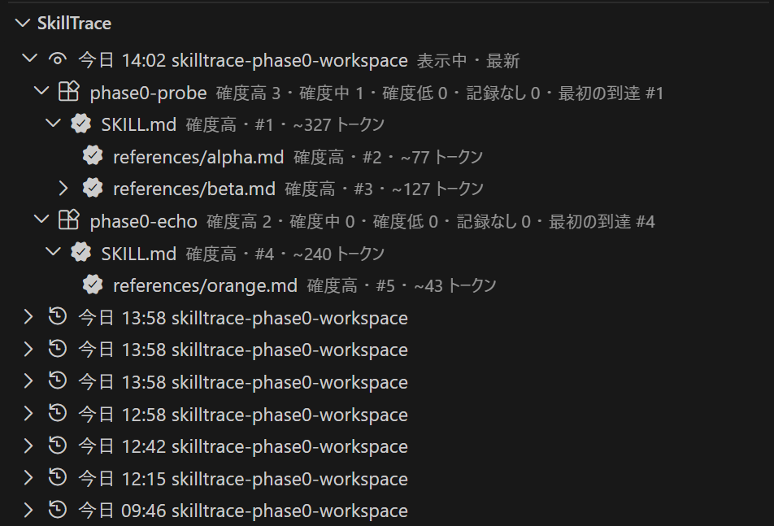
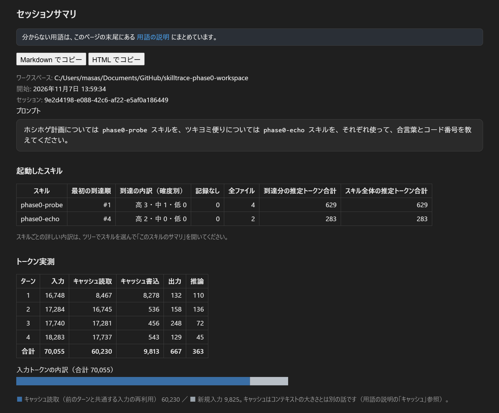
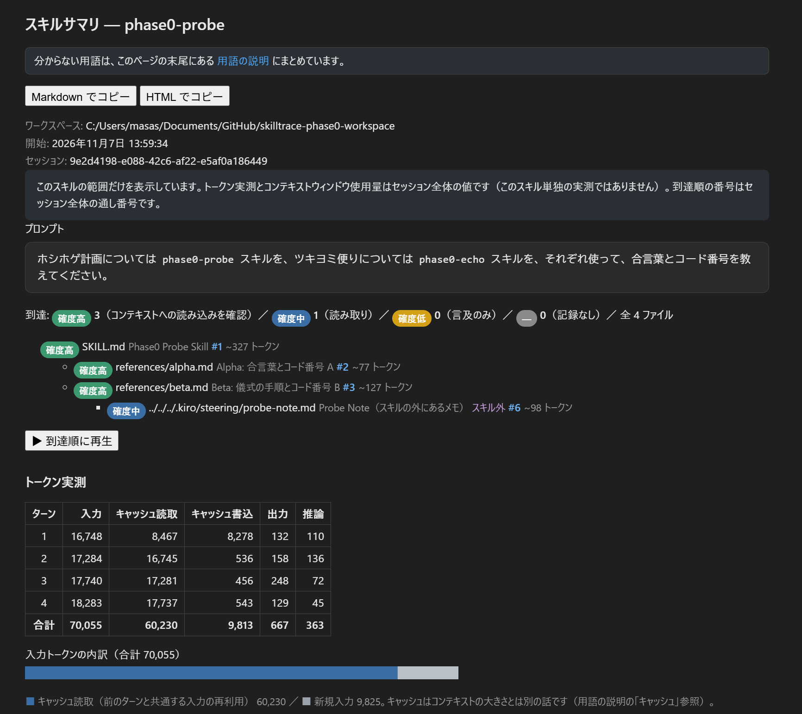

# SkillTrace-Solo

[](package.json)
[](https://marketplace.visualstudio.com/items?itemName=masanori-satake.skilltrace-solo)
[](https://open-vsx.org/extension/masanori-satake/skilltrace-solo)
[](https://github.com/masanori-satake/SkillTrace-Solo/releases)

<p align="center">
  <strong>Language / 言語:</strong> <a href="#english">English</a> | <a href="#japanese">日本語</a>
</p>

---

<a id="english"></a>
## English

**SkillTrace-Solo** is a lightweight, 100% local VS Code extension that shows which files an AI agent *actually* loaded while running an Agent Skill — the dynamic counterpart to [SkillMap-Solo](https://marketplace.visualstudio.com/items?itemName=masanori-satake.skillmap-solo), which analyses the same skills statically.

When GitHub Copilot or Amazon Kiro runs a skill, it follows references from `SKILL.md` into `references/` and beyond — but nothing on screen tells you how far it really got, what it cost, or how full the context window became. SkillTrace overlays the session records the agents already write (Copilot CLI: `~/.copilot/session-state/<id>/events.jsonl`; Kiro: `~/.kiro/sessions/<bucket>/sess_<uuid>/`; VS Code chat: `workspaceStorage/<hash>/chatSessions/<id>.jsonl`) onto the skill's reference graph, and reports, per file, the certainty that it arrived, the measured usage (tokens for Copilot, credits for Kiro), and the context window usage. No setup is required: the records are written by default, and past sessions can be analysed retroactively.

Current version: **v1.8.0**

---

<a id="en-toc"></a>
### 📑 Table of Contents

- [💡 Key Features](#en-key-features)
- [📦 Installation & Updates](#en-installation)
- [🚀 How to Use](#en-how-to-use)
- [⌨️ Commands](#en-commands)
- [🔧 Settings](#en-settings)
- [📋 Requirements](#en-requirements)
- [🔒 Data Storage & Privacy](#en-privacy)
- [⚠️ Known Limitations](#en-limitations)
- [🧭 Roadmap](#en-roadmap)
- [🛠️ Developer Documentation](#en-developer-docs)
- [📄 License](#en-license)

---

<a id="en-key-features"></a>
### 💡 Key Features

1. **Session history tree — no importing, no target switching**
   - Sessions from Copilot, Kiro and VS Code chat appear together in the Explorer view as a history (newest first; Kiro sessions are labelled "Kiro", VS Code chat sessions "VS Code"): session → invoked skills (in invocation order, multiple skills supported) → reference tree.
   - While you look at the newest session, the view follows new records live (follow-tail). While you inspect a past session, new sessions only join the history with a badge — your view is never hijacked.

2. **Arrival certainty, per file**
   - **High** — the record confirms the content was loaded into the model's context. **Medium** — a file-reading tool call succeeded. **Low** — the file was only mentioned.
   - Files with no record are labelled "no record", which does **not** prove they were not read. Arrival order numbers run across the whole session, and a replay button lights the files up in that order.

3. **Measured usage and context window usage**
   - Per-turn and total usage from the session record. Copilot: input / output / cache read / cache write / reasoning tokens, plus how much of the input was cache reuse. Kiro: credits per turn, because Kiro's records carry no token counts. VS Code chat: input / output tokens and credits per request, because its records carry both.
   - A context window usage graph shows how full the window became at the last turn (for Kiro, the usage percentage the record snapshots) — the overflow that silently degrades answer quality becomes visible. The transition is also carried into copied documents: an SVG chart in HTML, and a block-character sparkline with the peak in Markdown.
   - Sessions in which no skill was activated (for example spec-driven work in Kiro) still show the always-loaded context (steering / AGENTS.md) and the measured usage, when the record has them.

4. **Two-layer summaries that explain themselves**
   - A session summary (the user's view) and per-skill summaries (the provider's view), each self-contained: terminology used in the summary is explained in a glossary section at the end of the same page, using the Agent Skills community's standard terms (activation, progressive disclosure, context window, …).

5. **Built for sharing in discussions**
   - Copy the tree as text (whole / visible part / a chosen subtree), with certainty and arrival order attached.
   - Copy a summary as a self-contained document in Markdown or HTML — ready to paste into Microsoft Loop, PowerPoint, GitHub or Notion. Whether the "how to read" notes and the glossary travel with the document is a setting (off by default).

6. **Per-skill totals across the history**
   - The "Skill totals" entry at the top of the history aggregates the sessions shown in the history (up to 30 most recent per source) by skill: sessions, activations, and measured consumption (Kiro / Copilot Chat credits, Copilot tokens), with different units never added together. Credits and token counts are whole-session measurements, not apportioned per skill — when several skills ran in one session, the same session total counts toward each of them.

7. **A learning aid, not just a meter**
   - Bundled learning docs (`docs/learning/`) explain the concepts behind the displays — "read" vs "loaded into context", token kinds and credits, and how Copilot's and Kiro's session records compare — using real session numbers. Open them from the "SkillTrace: Open Learning Docs" command.

---

<a id="en-installation"></a>
### 📦 Installation & Updates

- From the Visual Studio Marketplace: search for **SkillTrace-Solo**, or install from the [Marketplace page](https://marketplace.visualstudio.com/items?itemName=masanori-satake.skilltrace-solo). Updates arrive through VS Code as usual.
- From a VSIX file:
  1. Download `skilltrace-solo-1.8.0.vsix` from [GitHub Releases](https://github.com/masanori-satake/SkillTrace-Solo/releases)
  2. In VS Code, run "Extensions: Install from VSIX..." from the Command Palette and select the file.

---

<a id="en-how-to-use"></a>
### 🚀 How to Use

1. Use GitHub Copilot or Amazon Kiro with a skill as usual — no configuration is needed on the agent side.
2. Open the **SkillTrace** view in the Explorer. Your sessions are listed automatically, newest first.
3. Expand a session to see the skills it invoked and how far each reference chain arrived. Click the summary icon on a session (or a skill) to open its summary.
4. To share findings, right-click a session or skill for the copy commands, or use the copy buttons at the top of a summary.

**Session history tree** — sessions, the skills they invoked, and how far each reference chain arrived:



**Session summary** — a per-skill digest, measured tokens, and the input breakdown:



**Skill summary** — arrival certainty per file, the arrival tree, and replay:



---

<a id="en-commands"></a>
### ⌨️ Commands

| Command | What it does |
|---|---|
| SkillTrace: Show Session Summary | Open the session summary for the selected (or current) session |
| SkillTrace: Open Summary in Browser | Open the session summary as a standalone HTML page in your browser |
| SkillTrace: Copy Tree (All) / (Visible) | Copy a session's whole arrival tree, or only the expanded part, as text |
| SkillTrace: Copy Subtree | Copy from the selected node down, as text |
| SkillTrace: Copy Session Summary as Markdown | Copy the session summary as a Markdown document |
| SkillTrace: Copy Skill Summary as Markdown | Copy one skill's summary as a Markdown document |
| SkillTrace: Open Learning Docs | Open the bundled learning documents |
| SkillTrace: Toggle Auto-Follow | Follow the newest session live, or pause following |

---

<a id="en-settings"></a>
### 🔧 Settings

| Setting | Default | Description |
|---|---|---|
| `skilltrace.autoFollowLatest` | `true` | Keep the newest session in view and update live (follow-tail: viewing a past session is never interrupted) |
| `skilltrace.documentIncludeNotes` | `false` | Include the "how to read" notes and the glossary in document copies (Markdown / HTML) |
| `skilltrace.sessionStateDir` | (auto) | Override the Copilot CLI session-state directory |

---

<a id="en-requirements"></a>
### 📋 Requirements

- VS Code 1.90 or later.
- GitHub Copilot, with sessions run through Copilot CLI / the VS Code agent host so that records exist under `~/.copilot/session-state/`.
- Amazon Kiro, with sessions recorded in the v3 session store under `~/.kiro/sessions/`.
- VS Code's built-in Copilot Chat, with sessions recorded under the VS Code user data folder's `workspaceStorage/<hash>/chatSessions/`.

---

<a id="en-privacy"></a>
### 🔒 Data Storage & Privacy

- **100% local.** No network access, no telemetry, no tracking.
- **Read-only.** The tool reads session records and skill files; it never modifies the agent, the skill, or the session it observes — it changes how things are *shown*, never the target.
- Session records are read from `~/.copilot/session-state/`, `~/.kiro/sessions/` and the VS Code user data folder's `workspaceStorage/` on your machine. Summaries display the first 120 characters of the session's first prompt so you can tell sessions apart; nothing leaves your machine.

---

<a id="en-limitations"></a>
### ⚠️ Known Limitations

- If a platform's record format changes, some arrivals may no longer be matched; "no record" must never be read as "not read".
- For Kiro sessions, usage is shown in credits and context usage as a percentage, because Kiro's records carry no token counts; the two platforms' figures cannot be converted into each other.
- Token counts shown per file are estimates from file size; only the usage figures labelled "measured" come from the session record.
- The static context-window gauge (estimated skill size vs each model's window) is not in v1 — it is planned together with SkillMap-Solo, which owns static analysis.

---

<a id="en-roadmap"></a>
### 🧭 Roadmap

- Session comparison
- Static context-window gauge, in coordination with SkillMap-Solo
- History search and filtering
- Learning docs, part 2 (based on use in other environments)

---

<a id="en-developer-docs"></a>
### 🛠️ Developer Documentation

```bash
npm install
npm test        # type-check + unit tests (fixtures fixed to the Phase 1 CLI ground truth)
npm run compile # build (esbuild) into dist/
npm run package # production build
```

Runtime dependencies: none. The analysis core (`src/core/`) is pure TypeScript with no VS Code dependency, so it is unit-testable as-is.

---

<a id="en-license"></a>
### 📄 License

MIT — see [LICENSE](LICENSE).

---

<a id="japanese"></a>
## 日本語

**SkillTrace-Solo** は、AI エージェントが Agent Skill を実行したときに *実際に* どのファイルを読み込んだかを表示する、軽量・100%ローカルの VS Code 拡張機能です。同じスキルを静的に解析する [SkillMap-Solo](https://marketplace.visualstudio.com/items?itemName=masanori-satake.skillmap-solo) に対する、動的解析の担当です。

GitHub Copilot や Amazon Kiro がスキルを実行すると、`SKILL.md` から `references/` やその先へ参照を辿ります。しかし画面のどこを見ても、実際にどこまで辿り着いたか、いくら消費したか、コンテキストウィンドウがどれだけ埋まったかは分かりません。SkillTrace は、エージェントが標準で書き出しているセッション記録（Copilot CLI: `~/.copilot/session-state/<id>/events.jsonl`、Kiro: `~/.kiro/sessions/<バケット>/sess_<UUID>/`、VS Code チャット: `workspaceStorage/<ハッシュ>/chatSessions/<ID>.jsonl`）をスキルの参照グラフに重ね、ファイルごとの到達の確度、実測（Copilot はトークン、Kiro はクレジット）、コンテキストウィンドウ使用量を表示します。設定は不要で、記録は標準で書かれるため、過去のセッションも後から分析できます。

現在のバージョン: **v1.8.0**

---

<a id="ja-toc"></a>
### 📑 目次

- [💡 主な機能](#ja-key-features)
- [📦 インストールと更新](#ja-installation)
- [🚀 使い方](#ja-how-to-use)
- [⌨️ コマンド](#ja-commands)
- [🔧 設定](#ja-settings)
- [📋 動作要件](#ja-requirements)
- [🔒 データの保存とプライバシー](#ja-privacy)
- [⚠️ 既知の制限](#ja-limitations)
- [🧭 ロードマップ](#ja-roadmap)
- [🛠️ 開発者向け情報](#ja-developer-docs)
- [📄 ライセンス](#ja-license)

---

<a id="ja-key-features"></a>
### 💡 主な機能

1. **セッション履歴ツリー — 取り込みも対象切り替えも不要**
   - Copilot と Kiro、VS Code チャットのセッションが、エクスプローラーのビューに履歴として一緒に（新しい順に、Kiro のセッションには「Kiro」、VS Code チャットのセッションには「VS Code」と表示）並びます: セッション → 起動したスキル（起動順、複数対応）→ 参照ツリー。
   - 最新セッションを見ている間は新しい記録にライブで追随し（follow-tail）、過去のセッションを精査している間は新着が履歴とバッジにだけ現れます。表示が横取りされることはありません。

2. **ファイルごとの到達の確度**
   - **確度高**: 内容がモデルのコンテキストに読み込まれたことを記録で確認できた。**確度中**: ファイルを読むツール呼び出しが成功した。**確度低**: 言及のみ。
   - 記録が見つからないファイルは「記録なし」と表示します。これは「読まれていない」ことの証明ではありません。到達順の番号はセッション全体の通し番号で、再生ボタンでその順に点灯させることもできます。

3. **実測とコンテキストウィンドウ使用量**
   - セッション記録から、ターン別と合計の実測を表示します。Copilot は入力 / 出力 / キャッシュ読取 / キャッシュ書込 / 推論トークンと、入力のうちキャッシュ再利用で済んだ割合。Kiro は記録にトークン数がないため、ターンごとのクレジットで表示します。VS Code チャットは記録に両方が残るため、入力 / 出力トークンとリクエストごとのクレジットを表示します。
   - コンテキストウィンドウ使用量のグラフで、最後のターン時点で窓がどれだけ埋まっていたかを表示します（Kiro は記録に残る使用率 %）。静かに精度を落とす「あふれ」が見えるようになります。推移は文書コピーにも入ります（HTML は SVG のグラフ、Markdown はブロック文字のスパークラインと最大値）。
   - スキルが起動しなかったセッション（Kiro の仕様駆動など）でも、記録にあれば常時文脈（steering / AGENTS.md）と実測を表示します。

4. **説明が自己完結する二層のサマリ**
   - セッションサマリ（利用者の視点）とスキル別サマリ（提供者の視点）。どちらも、使われている用語は同じページの末尾にある「用語の説明」で解説します。用語は Agent Skills 界隈の標準的な言い方（activation、progressive disclosure、context window など）に揃えてあります。

5. **議論の場で共有するためのコピー**
   - ツリーをテキストでコピーできます（全体／表示中／選択した部分ツリー）。確度と到達順つきです。
   - サマリを自己完結な文書として Markdown / HTML でコピーでき、Microsoft Loop、PowerPoint、GitHub、Notion などにそのまま貼れます。「読み方の注意」と「用語の説明」を文書に含めるかどうかは設定で切り替えられます（既定は含めない）。

6. **履歴をまたいだスキル別集計**
   - 履歴の先頭にある「スキル別集計」から、履歴に表示中のセッション（供給源ごとに新しい順30件まで）をスキル単位に集計できます。セッション数、起動回数、実測の消費（Kiro / Copilot Chat のクレジット、Copilot のトークン）で、単位の異なる値は合算しません。クレジットとトークンはセッション全体の実測で、スキルへの按分はしていません。複数のスキルが起動したセッションでは、同じセッション合計が各スキルに入ります。

7. **計測ツールであり、学習の道具でもある**
   - 同梱の学習ドキュメント（`docs/learning/`）が、表示の背後にある概念 — 「読んだ」と「コンテキストに読み込まれた」の違い、トークンの種類とクレジット、Copilot と Kiro のセッション記録の対比 — を、実セッションの数値で解説します。「SkillTrace: 学習ドキュメントを開く」コマンドから開けます。

---

<a id="ja-installation"></a>
### 📦 インストールと更新

- Visual Studio Marketplace から: **SkillTrace-Solo** で検索するか、[Marketplace のページ](https://marketplace.visualstudio.com/items?itemName=masanori-satake.skilltrace-solo)からインストールしてください。更新は通常どおり VS Code 経由で届きます。
- VSIX ファイルから:
  1. [GitHub Releases](https://github.com/masanori-satake/SkillTrace-Solo/releases) から `skilltrace-solo-1.8.0.vsix` をダウンロードする
  2. VS Code のコマンドパレットで「Extensions: Install from VSIX...」を実行し、ファイルを選ぶ

---

<a id="ja-how-to-use"></a>
### 🚀 使い方

1. いつもどおり GitHub Copilot か Amazon Kiro でスキルを使ってください。エージェント側の設定は要りません。
2. エクスプローラーの **SkillTrace** ビューを開くと、セッションが新しい順に自動で並んでいます。
3. セッションを展開すると、起動したスキルと参照の連なりの到達状況が見えます。セッション（またはスキル）のサマリアイコンをクリックするとサマリが開きます。
4. 結果を共有するときは、セッションやスキルの右クリックメニューのコピーコマンドか、サマリ上部のコピーボタンを使ってください。

**セッション履歴ツリー** — セッション、起動したスキル、参照の連なりの到達状況:


**セッションサマリ** — スキルごとのダイジェスト、トークン実測、入力トークンの内訳:


**スキルサマリ** — ファイルごとの到達の確度、到達ツリー、到達順の再生:


---

<a id="ja-commands"></a>
### ⌨️ コマンド

| コマンド | 内容 |
|---|---|
| SkillTrace: セッションサマリを表示 | 選択中（または現在）のセッションのサマリを開く |
| SkillTrace: ブラウザでサマリを開く | セッションサマリを単独の HTML ページとしてブラウザで開く |
| SkillTrace: ツリー全体をコピー / 表示中のツリーをコピー | セッションの到達ツリー全体、または展開中の部分だけをテキストでコピーする |
| SkillTrace: 部分ツリーをコピー | 選択したノード以下をテキストでコピーする |
| SkillTrace: セッションサマリを Markdown でコピー | セッションサマリを Markdown 文書としてコピーする |
| SkillTrace: スキルサマリを Markdown でコピー | 1つのスキルのサマリを Markdown 文書としてコピーする |
| SkillTrace: 学習ドキュメントを開く | 同梱の学習ドキュメントを開く |
| SkillTrace: 自動追尾の切り替え | 最新セッションへのライブ追随を切り替える |

---

<a id="ja-settings"></a>
### 🔧 設定

| 設定 | 既定値 | 説明 |
|---|---|---|
| `skilltrace.autoFollowLatest` | `true` | 最新のセッションを表示し続け、記録の追記にライブで反応する（follow-tail 方式: 過去のセッションを見ている間は差し替えない） |
| `skilltrace.documentIncludeNotes` | `false` | サマリの文書コピー（Markdown / HTML）に「読み方の注意」と「用語の説明」を含める |
| `skilltrace.sessionStateDir` | （自動） | Copilot CLI のセッション記録フォルダを上書きする |

---

<a id="ja-requirements"></a>
### 📋 動作要件

- VS Code 1.90 以降。
- GitHub Copilot。セッション記録が `~/.copilot/session-state/` に書かれる形（Copilot CLI / VS Code のエージェントホスト）で実行されたセッションが対象です。
- Amazon Kiro。セッション記録が v3 セッションストア（`~/.kiro/sessions/`）に書かれるセッションが対象です。
- VS Code 標準の Copilot チャット。セッション記録が VS Code のユーザーデータフォルダ配下の `workspaceStorage/<ハッシュ>/chatSessions/` に書かれるセッションが対象です。

---

<a id="ja-privacy"></a>
### 🔒 データの保存とプライバシー

- **100%ローカル処理。** ネットワーク通信、テレメトリ、トラッキングは一切ありません。
- **読み取り専用。** セッション記録とスキルファイルを読むだけで、観測対象のエージェント・スキル・セッションを変更することはありません。変えるのは「見え方」だけで、対象そのものには触れません。
- セッション記録はお使いのマシンの `~/.copilot/session-state/` と `~/.kiro/sessions/`、VS Code のユーザーデータフォルダ配下の `workspaceStorage/` から読みます。サマリにはセッションを見分けるために最初のプロンプトの先頭120文字を表示しますが、外部に送信されることはありません。

---

<a id="ja-limitations"></a>
### ⚠️ 既知の制限

- プラットフォームの記録形式が変わると、到達の対応付けに漏れが出ることがあります。「記録なし」は「読まれていない」という意味では決してありません。
- Kiro のセッションでは、記録にトークン数がないため、実測はクレジット、文脈使用量は割合（%）で表示します。両プラットフォームの数値は相互に換算できません。
- ファイルごとに表示するトークン数はファイルサイズからの推定です。「実測」と付いている使用量だけがセッション記録由来の値です。
- 静的なコンテキストウィンドウ使用率ゲージ（スキルの推定サイズ ÷ モデル別の窓）は v1 には入っていません。静的解析を担う SkillMap-Solo と合わせて計画しています。

---

<a id="ja-roadmap"></a>
### 🧭 ロードマップ

- セッション比較
- 静的コンテキストウィンドウ使用率ゲージ（SkillMap-Solo と連携）
- 履歴の検索・フィルタ
- 学習ドキュメント第2弾（他環境での利用実績を踏まえて）

---

<a id="ja-developer-docs"></a>
### 🛠️ 開発者向け情報

```bash
npm install
npm test        # 型チェック＋単体テスト（フィクスチャは Phase 1 CLI の正解値に固定）
npm run compile # dist/ へビルド（esbuild）
npm run package # 本番ビルド
```

実行時依存はありません。解析コア（`src/core/`）は VS Code に依存しない純粋な TypeScript で、そのまま単体テストできます。

---

<a id="ja-license"></a>
### 📄 ライセンス

MIT — [LICENSE](LICENSE) を参照してください。
