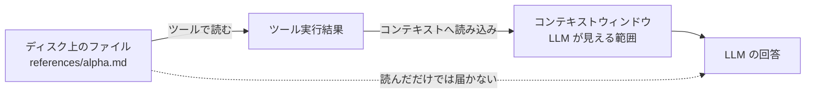

# 01. 「読んだ」と「読み込まれた」は違う

## この文書で分かること

- LLM の「コンテキストウィンドウ」とは何か
- エージェントがファイルを「読む」ことと、その内容が AI に「渡る」ことの違い
- SkillTrace の到達の確度「高」と「中」が、なぜ区別されているのか

> 実例の phase0-probe は、著者が検証用に作って自分の環境でだけ
> 動かしたダミースキルです（このリポジトリには含まれていません）。
> 出どころは[索引](README.md)の「実例の出どころ」を参照してください。

## 結論を先に

エージェントがファイルを読んでも、その内容が LLM に渡っていなければ、
LLM はその内容を知らない。「読んだ」は手続き、「読み込まれた」は実際に頭に入った状態。
この2つは別物で、セッション記録を見ると区別できる。

## コンテキストウィンドウという「作業机」

LLM は、会話のたびに「今から考える材料一式」を受け取って推論します。
その材料一式が入る場所が **コンテキストウィンドウ** です。
机の広さに上限があり、上限を超える材料は置けません。

机の上に置かれるもの:

- システム側の指示（エージェントの振る舞いの定義）
- 起動したスキルの SKILL.md 本文
- これまでの会話の履歴（質問と回答の全部）
- ツール実行の結果（読み取ったファイルの中身など）
- 追加でコンテキストに読み込まれた参照ファイルの内容

大事なのは、**ファイルがディスクにあるだけでは机に乗らない** という点です。
誰かが「読んで、机に置く」と決めて初めて、LLM はその内容を使って考えられます。

## 実セッションで起きたこと

ダミースキル phase0-probe のセッション（基礎データは索引参照）では、
4つのファイルの扱いが2種類に分かれました。

| ファイル | 記録のされ方 | 確度 |
|---|---|---|
| SKILL.md | 起動イベント（skill.invoked）の中に本文の見出しが含まれていた | 確度高 |
| references/alpha.md | context_delivered_ref（コンテキストへの読み込みの記録）に載った | 確度高 |
| references/beta.md | 同上 | 確度高 |
| .kiro/steering/probe-note.md（スキル外） | ツールで読まれた記録（tool.execution）だけがある | 確度中 |

alpha と beta は、ツールで読まれたうえに「コンテキストへ読み込まれた」ことが
専用のイベントとして残っていました。probe-note は読まれたものの、
その読み込みの記録には現れませんでした。

ただし注意: probe-note の内容（コード番号 S-9981、うぐいす色、7）は
最終回答に正しく使われています。つまり実際には内容は渡っていたはずで、
「読み込みの記録が別イベントとして残らなかった」だけです。
だから確度は「到達したことの確かさ」の表示であって、確度中は「使われていない」の意味ではありません。
**記録がないことと、起きていないことは違う** — これが計測の基本姿勢です。

## なぜこの区別が実務で効くか

スキルを書く側の典型的な失敗が、この区別で説明できます。

- **「references に分けたのに精度が落ちた」**: 分けたファイルが読まれていない（記録なし）、
  あるいは読まれてもコンテキストに読み込まれていない可能性がある。ポインタの書き方が弱いと起きる。
- **「全部 SKILL.md に書いたら消費が跳ねた」**: 全文が常時読み込まれるので、
  質問に関係ない部分まで毎回机に乗り続ける（02 のトークンの話につながる）。
- **progressive disclosure（段階的開示）** という設計は、この机の使い方の工夫です:
  SKILL.md には目次とポインタだけを置き、必要な references だけをその都度読み込ませる。

## 自分で確かめる方法

1. Copilot でスキルを使うセッションを1回実行する（何でもよい）
2. SkillTrace でそのセッションを開く
3. ツリーで 確度高 / 確度中 / 記録なし の分布を見る
4. 「読まれたはずなのに記録なし」のファイルがあれば、ポインタの書き方を見直す材料になる
