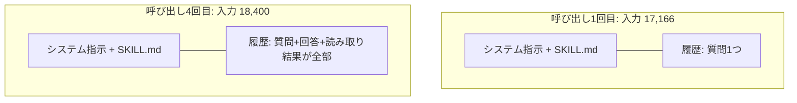

# 02. トークンの種類とクレジット

## この文書で分かること

- トークンの種類（input / output / cache read / cache write / reasoning）の意味
- 会話が進むほど入力トークンが増えていく理由
- 「入力トークン合計」の正しい読み方（クレジット消費との関係）

> この文書の「基礎データのセッション」は、著者が検証用に作って
> 自分の環境でだけ動かしたダミースキル phase0-probe の実行記録です
> （このリポジトリには含まれていません）。出どころは
> [索引](README.md)の「実例の出どころ」を参照してください。

## 出発点の疑問

基礎データのセッションでは、スキル本体は4ファイル・推定629トークンしかないのに、
入力トークンの実測合計は **71,271** でした。100倍以上です。なぜでしょう。

答えは「入力トークンは、呼び出しのたびに、その時点の机の上の材料全部を数え直すから」です。

## 1回の呼び出しで何が送られるか

エージェントが LLM を呼ぶ（ターンの中の1回の推論）たびに、
コンテキストウィンドウの中身がまるごと入力として送られます。

実セッションの入力トークンは 17,166 → 17,627 → 18,078 → 18,400 と増え続けました。
履歴が積み上がる分だけ、毎回の入力が重くなる。最終的に机の上は 19,561 トークン分まで埋まりました。

つまり「入力トークン合計 71,271」は、この4回の呼び出しの単純な合計です。
消費（クレジット）の観点ではこれが正しい読み方で、各呼び出しはそれぞれ課金対象だからです。
逆に「そのとき机に何が載っていたか」を知りたいときは、合計ではなく
コンテキストウィンドウ使用量（最後は 19,561）の方を見ます。**合計と現在量は、別の問いに答える数字**です。

## トークンの種類

| 種類 | 意味 | 実セッション |
|---|---|---|
| input（入力） | その呼び出しで送られた全材料。cache 分を含む総量 | 合計 71,271 |
| output（出力） | LLM が生成した文章・ツール指示 | 合計 770 |
| cache read（キャッシュ読取） | 前回と共通する部分を、キャッシュから再利用した分。安く・速い | 合計 52,862 |
| cache write（キャッシュ書込） | 新しくキャッシュに登録した分 | 合計 18,397 |
| reasoning（推論） | モデル内部の思考に使った分（出力には現れない） | 合計 355 |

見どころは cache read の大きさです。入力 71,271 のうち 52,862（約74%）はキャッシュ再利用でした。
ターンをまたいで共通する部分（システム指示、SKILL.md、履歴の前半）は、
毎回ゼロから処理されずにキャッシュが効いています。
**SKILL.md を大きくすると、この「毎回キャッシュに乗る固定部分」が太る** ため、
長いセッションほど効いてきます。これが「SKILL.md は小さく、references に分ける」
と言われる理由の、数字での裏付けです。

もう1つ: output は 770 と小さい。回答そのものは短くても、
消費の大半は「考える材料を送る側」で起きています。
エージェントの消費を考えるときは、出力より入力の設計が主戦場です。

## クレジットとの関係（Copilot の場合）

GitHub Copilot の AI Credits は、入力・キャッシュ・出力のトークン数に
モデルごとの単価を掛けた線形の計算で公開されています。
なので「どのターンで、どの種類が、どれだけ増えたか」が分かれば、
消費の内訳はそのまま説明できます。SkillTrace のターン別表は、その内訳表です。

（Kiro のクレジットは計算式が非公開の「仕事量の単位」なので、
同じ読み方はできません。トークン実測は Copilot 側の物差しです。）

## 自分で確かめる方法

1. 同じスキルで、短い質問と長い質問（references を多く読む質問）を別セッションで実行する
2. SkillTrace で2つのセッションのサマリを開き、トークン実測の表を見比べる
3. 入力合計とキャッシュ書込の差を見ると、「追加で読まれた references の値段」が見える
