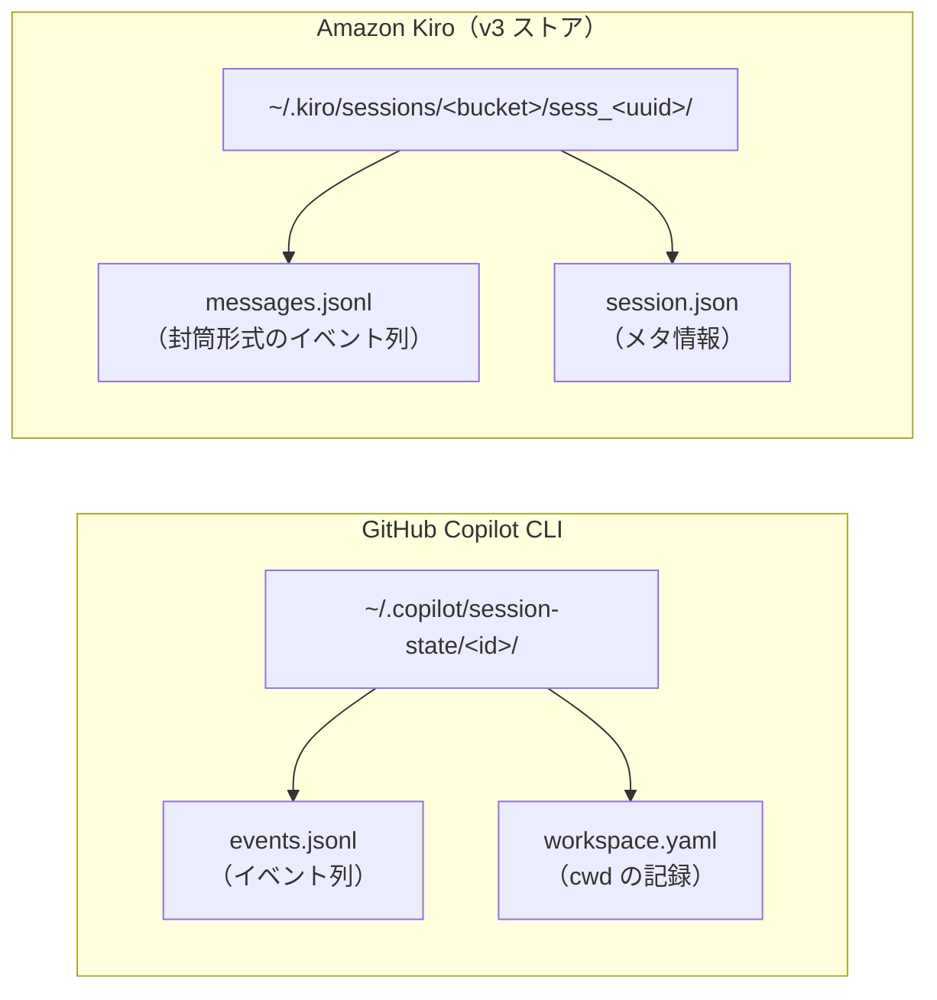

# 03. Copilot と Kiro のセッション記録を読み比べる

## この文書で分かること

- GitHub Copilot と Amazon Kiro が、セッションの記録をどこに、どんな形式で残すか
- 「スキルが起動した」「参照ファイルを辿った」「常時文脈が読み込まれた」が、
  それぞれの記録ではどう表れるか
- 実測の単位の違い（トークンとクレジット）と、コンテキストウィンドウ使用量の
  記録のされ方の違い
- 記録を対応付けるときの落とし穴（実機確認で実際に踏んだもの）

本書の内容は、2026-11-07〜08 に実機で両プラットフォームの記録を直接読んで
確認した事実に基づきます。数値はすべて実例セッションの実測です。

## 出発点の疑問

「スキルが SKILL.md から参照を辿って、どこまで読んだのか知りたい」——
SkillTrace が答えたい問いは、Copilot でも Kiro でも同じです。
ところが、答えの材料になるセッション記録は、置き場所も、形式も、
実測の単位も、プラットフォームごとにまったく違います。

同じ問いへの答え方がどう違うのかを、記録そのものを読み比べることで理解するのが
この文書の目的です。

## 1. 全体像



| 観点 | GitHub Copilot | Amazon Kiro |
| --- | --- | --- |
| 保存場所 | `~/.copilot/session-state/<セッションID>/` | `~/.kiro/sessions/<バケット>/sess_<UUID>/` |
| 記録ファイル | `events.jsonl` | `messages.jsonl` |
| 1行の形 | イベントそのもの（`type` が最上位） | 封筒 `{id, timestamp, payload}`、本体は `payload` の中 |
| 種別のキー | `type`（ドット区切り: `skill.invoked` 等） | `payload.type`（スネークケース: `tool_call` 等） |
| メタ情報 | 同じフォルダの `workspace.yaml` に `cwd` | `session.json` に title / createdAt / modelId / agentMode |
| ワークスペース | `cwd` が1つだけ記録される | `workspacePaths` / `rootPaths` に複数記録（マルチルートが前提） |
| スキル起動 | `skill.invoked` イベント | `tool_call`（actionType = `disclose_context`、引数はスキル名） |
| 参照の辿り | `tool.execution_complete` の成功＋パス | `tool_call`（actionType = `read_files`、引数にパス）＋ `tool_result` |
| 常時文脈 | `skill.context_delivered_ref` 等の配送イベント | `steering_inclusion` の `documents`（file:// URI の一覧） |
| 実測 | トークン内訳（input / output / cache / reasoning） | クレジット（ターン単位、`usage_summary`） |
| 文脈使用量 | `context_current_tokens`（絶対量）と上限 | `contextUsage`（`usagePercentage`、割合のみ） |
| 呼び出しと結果の対応 | `toolCallId` | `toolCallId`（`executionId` はターン共通なので使えない） |
| 到達順の土台 | 行順（＋ timestamp） | 行順（＋ timestamp） |

## 2. Copilot の記録（events.jsonl）

### 形

1行 = 1イベントで、キーは `type` / `timestamp` / `id` / `parentId` / `data` です。
中身は `data` の中にあり、イベント種別ごとに形が変わります。

```json
{"type":"session.usage_record","timestamp":"2026-11-07T09:20:44.000Z","id":"e24","parentId":null,"data":{"usage":{"inputTokens":8200,"outputTokens":120,"cacheReadTokens":4000,"cacheWriteTokens":300,"reasoningTokens":0},"context_current_tokens":9100,"context_token_limit":200000}}
```

### 主なイベント種別

| type | 意味 |
| --- | --- |
| `session.start` / `session.end` | セッションの開始と終了 |
| `user.message` / `assistant.message` | 利用者の発言とモデルの応答 |
| `assistant.turn_start` / `assistant.turn_end` | ターン（1回の依頼処理）の区切り |
| `skill.invoked` | スキル起動。SKILL.md の見出しが文字列として含まれるため、「起動時に本文が読み込まれた」ことまで裏付けられる |
| `skill.invoked_ref` | 起動に伴う参照の言及 |
| `skill.context_delivered_ref` | 参照ファイルの内容がコンテキストへ読み込まれた（配送された）記録 |
| `tool.execution_start` / `tool.execution_complete` | ツール呼び出しの開始と完了。完了側に成否（`success`）がある |
| `session.usage_record` | ターンごとの実測（トークン内訳と、その時点のコンテキスト使用量） |
| `hook.start` / `hook.end`、`permission.requested` / `permission.completed` | フックと権限確認の記録 |

### 特徴

- **スキルに関する専用イベントがある**。起動（`skill.invoked`）と
  コンテキストへの読み込み（`skill.context_delivered_ref`）が別イベントとして
  明示されるため、「読んだ」と「読み込まれた」の区別（01 のテーマ）が
  記録の上で直接できます
- **実測はトークンの内訳で残る**。入力・出力・キャッシュ読取・キャッシュ書込・
  推論が分かれ、`context_current_tokens`（現在の使用量・絶対量）と
  `context_token_limit`（上限）も同じ行にあります
- **ワークスペースは `cwd` が1つ**。マルチルートワークスペースのセッションでは、
  どのフォルダの記録かは `cwd` からしか分かりません

## 3. Kiro の記録（v3 セッションストア）

### 形

セッションは `~/.kiro/sessions/<16桁のバケット>/sess_<UUID>/` に置かれ、
`session.json`（メタ情報）と `messages.jsonl`（記録本体）からなります。

`messages.jsonl` の1行は封筒形式で、`{id, timestamp, payload}` の
`payload` の中に本体があります。本体の種別は `payload.type` です。

`session.json` には使用量は含まれず、代わりにワークスペースの情報が
しっかり記録されます。実測したセッションでは `workspacePaths` が3件、
`rootPaths` が12件（Solo 系リポジトリ一式）入っていました。
マルチルートが前提の設計です。

### 主な payload.type

実測した2セッションの内訳は、ほぼ次の顔ぶれでした。

| payload.type | 意味 |
| --- | --- |
| `session_start` / `session_event` | セッションの開始と境界イベント |
| `user` / `assistant` | 利用者の発言とモデルの応答。`user` 側にも `documents`（取り込まれた文書）が付くことがある |
| `turn_start` / `turn_end` | ターンの区切り |
| `tool_call` / `tool_result` | ツール呼び出しと結果。呼び出し側に `actionType` と `args`、結果側に `success`（真偽値）がある |
| `steering_inclusion` | そのターンでコンテキストに取り込まれた文書の一覧（`documents`、file:// URI） |
| `usage_summary` | ターン単位の実測。クレジットと使用ツールが残る |
| `session_metadata` | キー・バリュー形式のスナップショット。`key = contextUsage` で文脈使用率が残る |
| `pending_interaction` / `interaction_resolved` | 確認待ちと、その解決 |

### スキル起動は disclose_context

Kiro にはスキル専用のイベント種別がありません。スキル起動はツール呼び出しの
一種として記録されます。

- `tool_call` の `actionType` が `disclose_context`、引数が `{"name": "<スキル名>"}`
  —— これがスキル起動（activation）の記録です
- `disclose` は progressive disclosure（段階的開示）の「開示」そのもので、
  起動したスキルの内容をコンテキストへ開示するための仕組みです
- ただし結果（`tool_result`）の `content` は短い受領情報で、SKILL.md の本文
  そのものではありませんでした（実測 104 文字）。本文は、起動の直後に続く
  `read_files` で改めて読まれていました

### 参照の辿りは read_files

- `tool_call` の `actionType` が `read_files`、引数が
  `{path, offset, limit}` —— 読み取り対象のパスがそのまま残ります
- 対応する `tool_result` の `success` で成否が分かります
- 呼び出しと結果の対応付けは **`toolCallId`** で行います。
  `executionId` はターン内の全イベントで共通の値なので、対応付けには使えません
  （実機確認で踏んだ落とし穴の1つです。§6）

### 常時文脈は steering_inclusion

`steering_inclusion` の `documents` には、そのターンでコンテキストに
取り込まれた文書の file:// URI が並びます。実測したセッションでは
AGENTS.md と `.kiro/steering/` の3文書、計5件が入っていました。
スキル起動とは別に「常にかかっている文脈」がどれかが、この一覧で分かります。
steering のないワークスペースでは、このイベント自
...[truncated 9113 chars]