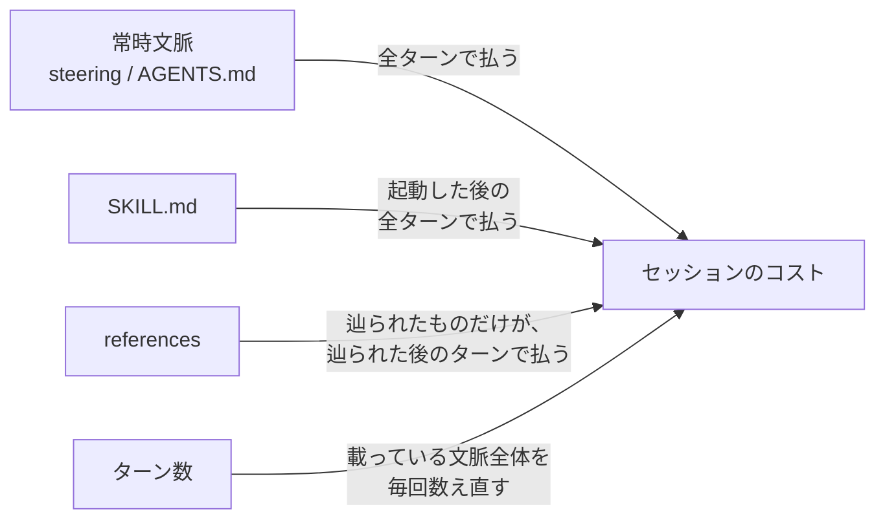
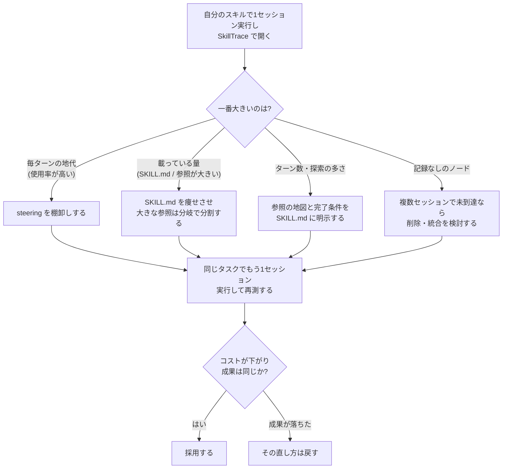

# 05. スキルを安くする — 同じ成果でコストを下げる直し方

## この文書で分かること

- スキルのコストが「どこで」発生するか（支払いのタイミングは3種類しかない）
- SkillTrace のどの数字を見て、スキルのどこを、どう直すかの判断
- 直した効果をどう確かめるか（安くなったのに成果が落ちた、を見分ける）

> 実例の phase0-probe / kiro-probe は、著者が検証用に作って自分の
> 環境でだけ動かしたダミースキルです（このリポジトリには含まれて
> いません）。出どころは[索引](README.md)の「実例の出どころ」を
> 参照してください。

この文書は、シリーズの中で唯一「直し方」を扱います。前提の仕組み
（01〜04）を全部読んでいなくても、この文書だけで判断して行動に
移せるように書きました。数字の読み方の詳細は 04、仕組みそのものは
01・02 を参照してください。

## 大原則: 前提は「成果が同じ」こと

コストを下げる話は、成果が同じでなければ意味がありません。
必要な手順や例を削って出力の質が落ちたら、それは「安くなった」
のではなく「別の（劣る）スキルになった」だけです。
以降の直し方はすべて、「成果を変えずに、払い方だけを変える」
ものとして読んでください。

## コストの発生構造: 支払いのタイミングは3種類

セッションのコストは、おおまかに

**（そのターンで文脈に載っていた量）の全ターン分の合計**

で決まります（Copilot ではトークン実測、Kiro ではクレジットとして
現れます）。そして、スキルに関わる文書が文脈に載るタイミングは
3種類しかありません。

読み取りの単位はファイルです。ファイルが文脈に載ると、その内容は
以降のターンでも数え直され続けます（多くはキャッシュ読取として
安く再利用されますが、ゼロにはなりません。02 参照）。
したがって、効く手は次の3つに限られます。

1. **載せる量を減らす** — 文書そのものを小さくする
2. **載せる範囲を下げる** — 「毎ターン」→「起動時」→
   「必要になったときだけ」へ、置き場所を格下げする
3. **ターン数を減らす** — エージェントが迷わず、最短で収束する
   ように導く

実例でもこの構造が見えます。自宅環境の Kiro では、最小構成の
プローブの1ターンが 0.82 credits、steering 等が大量に常時読み
込まれる環境の1ターンが 19.88 credits でした。差の主な要因は
「毎ターン払う常時文脈」の量です（04 参照）。

## 判断表: どの数字を見て、どこを直すか

SkillTrace のサマリとツリーに出る観測から、直す場所を引くための
表です。上から順に「効きやすいもの」を並べています。

| 観測（SkillTrace のどこに出るか） | 読み取り | 直す場所と直し方 |
| --- | --- | --- |
| 最初に記録された文脈使用率が高い（Kiro のサマリ・ツリー）／ターン単価が一様に高い | 常時文脈の「地代」が全ターンを押し上げている | **steering の棚卸し。** その内容が「全セッション・全ターンで常に必要か」を問う。タスク依存の内容はスキル側（SKILL.md / references）へ移し、常時文脈にはプロジェクトの前提・禁止事項など常時効くものだけを残す |
| SKILL.md の推定トークンが大きい／スキル起動後の入力が嵩む | SKILL.md は起動のたびに全文が載り、以後も残り続ける | **SKILL.md を痩せさせる。** 残すのは判断材料だけ: いつ使うか、参照の地図、外せないルール。手順の詳細・例・背景説明は references へ出す。SKILL.md は「地図とルール」、詳細は参照側が原則 |
| 特定の参照ノードが大きく、確度高で繰り返し読まれる（ツリー・スキルサマリ） | 読み取りはファイル単位なので、その全文が毎回載る | **参照を判断の分岐で分割する。** 条件ごとにファイルに分け、必要な分岐だけを読ませる。本則と例、頻出ケースと例外ケースも分ける。分割は「必要な部分だけ読ませる」ための唯一の手段 |
| 記録なしのノードがある（ツリー・スキルサマリ） | そのセッションでは読まれていない。ただし「不要」の証明ではない（01 参照） | **複数セッションで一貫して記録なしなら、削除・統合の候補。** 例外経路（エラー時・まれな処理）は記録に現れにくいので、「なぜ置いたか」を確認してから判断する。1セッションの結果では決めない |
| 探索（検索）のツール実行が多い／到達まで遠回りしている（到達順・ツール実行） | エージェントがファイルの在りかを探してターン数を消費している。到達が遅い分だけ、文脈の再送も増える | **SKILL.md に地図を書く。** 「最初に読むファイル」「目的別の参照先」を明示し、ファイル名・見出しは内容が分かるものにする。プローブでもツール呼び出し8回のうち4回が探索だった（03 参照）。それが常態なら、スキルの案内が不足している |
| キャッシュ書込が初回以外のターンでも大きい（Copilot のサマリ） | 文脈の載せ直しが繰り返し起きている（04 参照） | **スキル側でできるのは「長大なセッションにしない」こと。** タスクの区切りでセッションを分ける運用にする。モデル切替や長時間放置による期限切れはスキル外の要因なので、まず切り分ける |
| ターン数が多く、失敗→やり直しの往復が見える（ターン別実測） | 往復のたびに、育った文脈全体を払い直す。一番高い払い方 | **手順の先頭に前提チェックと完了条件を置く。** 入力の検証・成功の定義・良い出力例を先に示し、一度で収束させる。例は1つでよい。「試行錯誤させる」設計はコストに直結する |

## 診断の流れ

迷ったら、この順で見ます。

## 効果の確かめ方

- **1回に1か所だけ変える。** 複数を同時に変えると、何が効いたか
  分からなくなります
- **同じタスクで比べる。** タスクが違えばコストも違います。
  直す前と後で、同じ依頼文・同じ材料のセッション同士を比べて
  ください
- **1セッションで判断しない。** 実測はセッションごとにぶれます。
  複数セッションの傾向で見ます
- **成果も見る。** コストだけ見て採用しない。出力が劣化していたら、
  それは節約ではありません
- **単価の換算値に最適化しない。** 単価表はモデルが代替わりする
  たびに変わります。変わらないのは「載せた量 × ターン数」という
  構造のほうです。実測とその構成比で判断してください（04 参照）

## やってはいけないこと

- **キャッシュ読取を敵視する。** それは安い再利用です。敵は
  キャッシュ書込（載せ直し）と、無駄なターンと、毎ターンの
  地代のほうです
- **記録なし ＝ 不要と即断する。** 記録に無いことは、読まれて
  いないことの証明ではありません（01 参照）
- **トークン削減そのものを目的にする。** 目的は「同じ成果を
  安く」です。削った結果、エージェントが探索や往復を増やせば
  逆効果になります

## 最初の30分でできること

1. 自分のスキルを1回実行し、そのセッションを SkillTrace で開く
2. Kiro なら「最初に記録された文脈使用率」、Copilot なら
   入力の3分解と書込の発生ターンを見る（04 参照）
3. 判断表で一番大きい要因を1つだけ選び、その直し方を入れる
4. 同じタスクでもう1セッション実行し、コストと成果の両方を
   前と比べる

## 深掘り

- 「読んだ」と「読み込まれた」の違い、到達の確度の意味: 01
- トークンの種類と、会話が進むほど消費が増える理由: 02
- Copilot と Kiro で記録の形がどう違うか: 03
- 3分解・発生ターン・使用率の読み方: 04
- この文書は 04 の「読み方」を「直し方」に変えたものです
